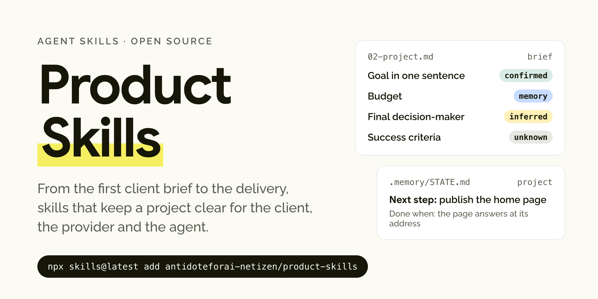
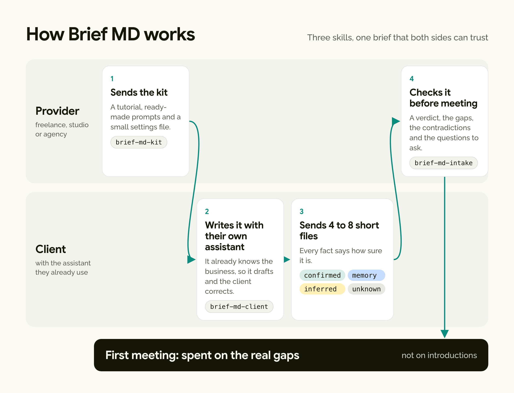
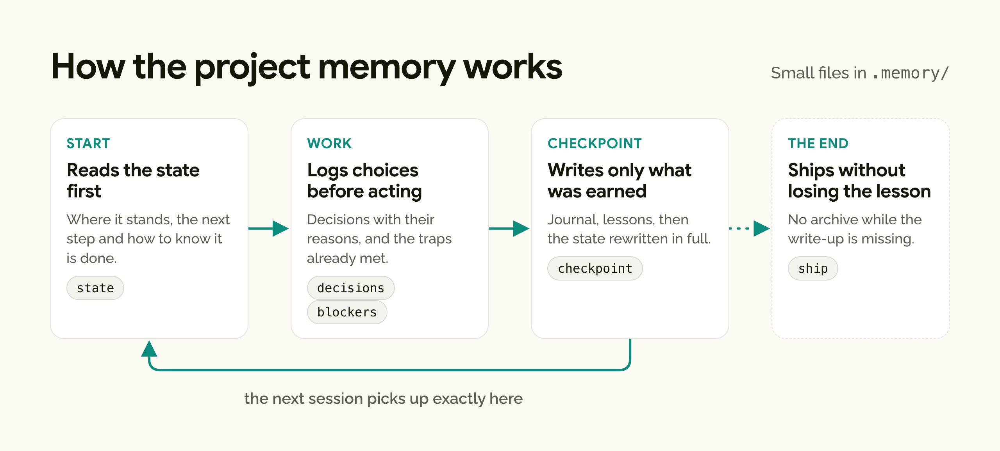

<picture>
  <source media="(prefers-color-scheme: dark)" srcset="./assets/banner-dark.png">
  
</picture>

# Product Skills

Skills for designers, developers and studios who run client projects with AI, from the first brief to the delivery.

Client projects usually go wrong at both ends. At the start, the brief sounds finished while it is full of guesses, and at the end nobody writes down what the project taught. In between, the agent forgets everything every morning. These skills cover those three moments with a few small Markdown files that people and agents can both read, check and keep.

They come from the method I use on my own projects, rewritten so that they work in any project without me in the room.

## Install

```bash
npx skills@latest add antidoteforai-netizen/product-skills
```

To install a single skill, add `--skill <name>`. A client who only needs to write their brief installs `--skill brief-md-client`.

## Brief MD

<picture>
  <source media="(prefers-color-scheme: dark)" srcset="./assets/brief-dark.png">
  
</picture>

The client's assistant often knows more about their business than any kickoff interview will uncover, because the client has been talking to it for months. Brief MD asks it for that context, one short file at a time, and makes every fact say how sure it is.

### Why it is worth it for the client

You have already explained your business to your assistant many times, so you should not have to explain it all over again in a two-hour meeting. Your assistant drafts the brief and you only correct it. You stay in control of what leaves your hands, because you read every file, a missing answer simply stays "unknown" instead of being invented, a password never goes into a file, and the file about your doubts can stay for a face-to-face conversation if you prefer. In return, the first meeting is about your project rather than introductions, and the quote rests on what you actually said.

### Why it is worth it for a freelancer or an agency

You get a brief you can check before you meet anyone. Each fact tells you whether the client confirmed it, whether their assistant remembered it or whether it was guessed, and a script checks the six things you cannot frame a project without (the goal, the success criterion, the decision-maker, the budget, the deadline and the main target). The intake skill then points out the contradictions while they still cost nothing, such as a scope that the budget cannot cover, and gives you the questions worth asking, ten at most, each with what it unblocks. You quote on facts, and the client sees a method from the very first contact.

- **[brief-md-kit](./skills/brief-md-kit/SKILL.md)**: for the provider, builds the kit to send before the project starts, with a step-by-step tutorial, a small settings file and prompts that work in any assistant.
- **[brief-md-client](./skills/brief-md-client/SKILL.md)**: for the client, guides them one file and one question at a time to write the brief with their own assistant, then packs it with its manifest.
- **[brief-md-intake](./skills/brief-md-intake/SKILL.md)**: for the provider, reads what comes back as untrusted data, runs the check and writes a framing with a verdict, the blocking gaps, the contradictions and the questions for the first meeting.

## Project memory

<picture>
  <source media="(prefers-color-scheme: dark)" srcset="./assets/memory-dark.png">
  
</picture>

An agent forgets everything between sessions, so you either explain the project again every morning or let it guess, and guessing is how settled decisions get reopened and known traps get walked into twice. Writing everything down at the very end does not work either, because by then the session is too long to summarize honestly. These skills write a few lines at each natural checkpoint, keep the present on a single screen, and refuse to start a step that has no condition anyone can check to say it is finished.

- **[state](./skills/state/SKILL.md)**: reads `STATE.md` first at the start of a session and rewrites it in full at the end, in fifteen lines at most, so that someone who reads only this file knows where to resume.
- **[journal](./skills/journal/SKILL.md)**: adds one short entry per checkpoint to `JOURNAL.md`, saying what was done, what blocks and what comes next.
- **[decisions](./skills/decisions/SKILL.md)**: logs a structural choice in `DECISIONS.md` before carrying it out, with the alternatives it beat and how to undo it, and flags any proposal that would contradict an earlier decision.
- **[blockers](./skills/blockers/SKILL.md)**: records in `BLOCKERS.md` the traps that already cost time and reads them before proposing an approach.
- **[learnings](./skills/learnings/SKILL.md)**: keeps in `LEARNINGS.md` the ways of working proven on this project, each with the observation that proves it.
- **[checkpoint](./skills/checkpoint/SKILL.md)**: reviews the session, decides file by file whether an entry is earned, writes only those and rewrites the state.
- **[ship](./skills/ship/SKILL.md)**: the last mile, a checklist that refuses to archive a delivered project while the README, a screenshot, the publication, the write-up or a recorded lesson is still missing.

Install the memory skills together, because `checkpoint` and `ship` rely on the others for the format of each file. They write into a `.memory/` folder at the root of the project rather than inside `.claude/`, which Claude Code protects from writing, and they reuse an existing folder such as `.claude/memory/` if your project already has one.

## Checking a brief by hand

`brief-md-client` and `brief-md-intake` ship the same checker, which needs nothing but Python 3:

```bash
python3 skills/brief-md-intake/scripts/brief_lint.py path/to/brief-folder-or.zip
```

It checks what a program checks better than an assistant (the expected files, headers, section titles, labels, secrets, personal data, hidden comments and instructions addressed to an AI) and never judges the substance. Every section title used by the three Brief MD skills comes from `scripts/spec.json`.

## License

MIT
